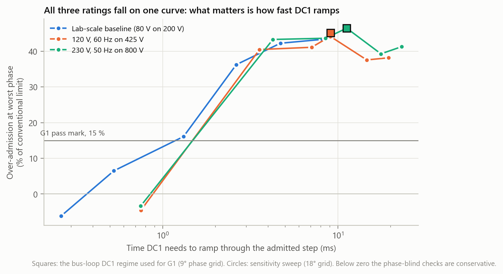

# WP1: realistic ratings and the G1 decision

Generated by `sim/wp1_report.py` from the pair-experiment and sensitivity results in `sim/results/` (baseline), `sim/results/r120/` and `sim/results/r230/`. All results are simulations of the illustrative circuit; nothing is measured.

## Ratings

| | Baseline | 120 V rating | 230 V rating |
|---|---|---|---|
| AC ports | 80 V peak, 50 Hz | 170 V peak, 60 Hz | 325 V peak, 50 Hz |
| Bus (limits) | 200 V (190–210) | 425 V (404–446) | 800 V (760–840) |
| Modulation index | 0.40 | 0.40 | 0.41 |
| AC1 / AC2 before step / DC2 | 150 / 100 / 50 W | 1200 / 800 / 400 W | 2400 / 1600 / 800 W |
| AC2 rating | — | 2400 W | 4800 W |
| Buffer Cb | 250 µF | 376 µF | 266 µF |
| Bus capacitor Cdc | 20 µF | 30 µF | 20 µF |
| Filter L / buffer Lb | 2 / 1 mH | 0.5 / 1 mH | 1.5 / 2 mH |
| DC1 slew, bus-loop regime | 50 W/ms | 121 W/ms (13.3 ms for the rated step) | 201 W/ms (15.9 ms for the rated step) |
| DC1 slew, fast regime | — | 3016 W/ms (0.53 ms) | 6032 W/ms (0.53 ms) |

The buffer is 1.2 times the smallest capacitance with a steady-state orbit at the rated AC2 power (the baseline keeps its original 250 µF).

**DC-side ramp basis.** Guidance for converters feeding single-phase loads keeps the DC-side voltage loop well below the double-line ripple: crossover below 24 Hz for 120 Hz ripple, with current loops above 600 Hz [1]. Overviews of second-harmonic current reduction in two-stage single-phase converters describe the same trade-off between DC-bus loop bandwidth and keeping the ripple out of the source [2, 3].

- **Bus-loop regime:** DC1 follows a loop with crossover at one fifth of the ripple frequency.
- **Fast regime:** DC1 gets a power feedforward through a 600 Hz current loop.
- **How the response becomes a slew:** each response is turned into the slew rate that leaves the same energy deficit as a first-order response to the rated step (ramp time 2τ).

## G1 decision (threshold fixed before the runs)

Pass mark: worst-phase over-admission of at least 15 % at both ratings, DC1 in the bus-loop regime, 9° phase grid.

| | Baseline | 120 V rating | 230 V rating |
|---|---|---|---|
| Worst phase | 261° | 207° | 198° |
| Step admitted by phase-blind checks | 263 W | 1096 W | 2256 W |
| Outer bound (largest feasible step) | 159 W | 601 W | 1208 W |
| Over-admission | **40 %** (104 W) | **45 %** (495 W) | **46 %** (1049 W) |
| G1 | reference | **pass** | **pass** |

**G1 overall: PASS.**

## Equal-energy pair and buffer sizing at each rating

| | Baseline | 120 V rating | 230 V rating |
|---|---|---|---|
| Pair (θa / θb) | 81° / 261° | 270° / 90° | 270° / 90° |
| AC2 step tested | 210 W | 1000 W | 1975 W |
| Band relaxation θb would need | 12.4 V | 32.5 V | 58.5 V |
| Cb, energy sizing + steady-state check | 221 µF | 285 µF | 195 µF |
| Cb needed at θb (necessary / sufficient) | 312 / 337 µF | 526 / 585 µF | 378 / 425 µF |
| Capacitance penalty at θb (H2 example 15 %) | +42 % | +85 % | +94 % |
| Time domain: conventional θa | held | held | held |
| Time domain: conventional θb | trips at 0.7 ms | trips at 8.9 ms | trips at 10.6 ms |
| Time domain: LP plan θa | held | held | held |

## Scope edge: the fast DC1 regime

| | 120 V rating | 230 V rating |
|---|---|---|
| DC1 slew | 3016 W/ms | 6032 W/ms |
| Over-admission at worst phase (18° grid) | -5 % | -3 % |

With a power feedforward and a fast DC1 current loop the phase effect is small or absent. The paper's scope condition is therefore that DC1 follows a slow bus loop, which is the usual design for single-phase systems with a battery or fuel cell.

## Sources

1. US Patent 7,518,886, multiphase soft-switched DC/DC converter and active control technique for fuel-cell ripple current elimination: https://image-ppubs.uspto.gov/dirsearch-public/print/downloadPdf/7518886
2. Control schemes for reducing second harmonic current in two-stage single-phase converter: an overview from DC-bus port-impedance characteristics: https://www.researchgate.net/publication/330587755
3. On the reduction of second harmonic current and improvement of dynamic response for two-stage single-phase inverter: https://www.researchgate.net/publication/270324126

G1 also requires WP0 (no prior work already gives the criterion), which is still open; this report decides only the simulation half of G1.
