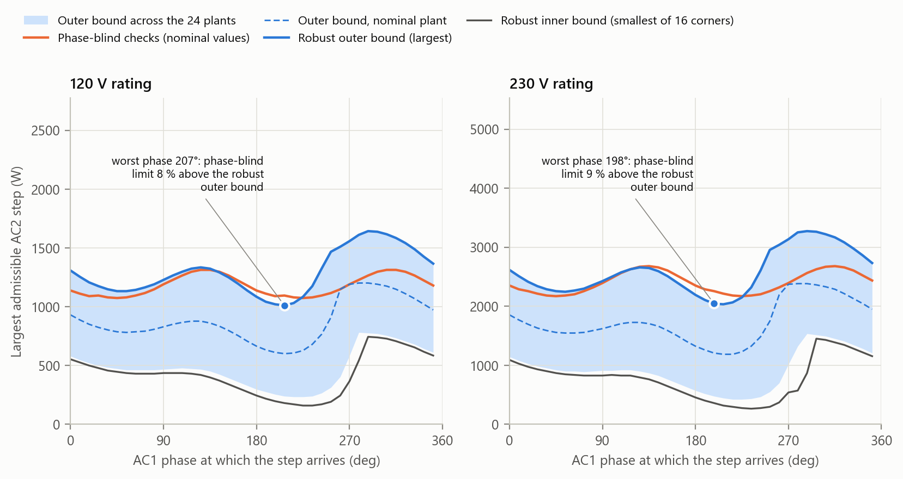
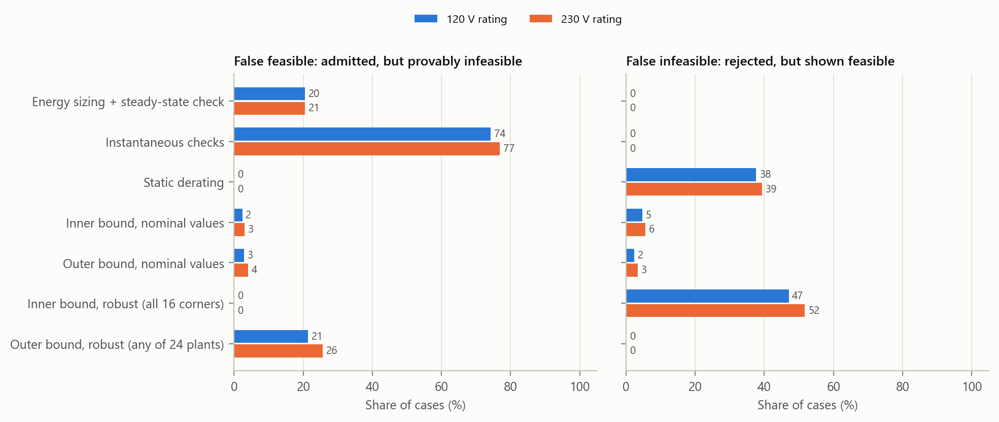
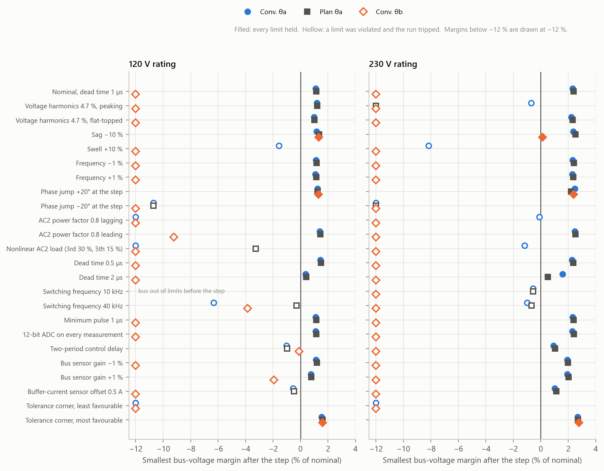

# WP4: robustness of the phase effect

Generated by `sim/wp4_report.py` from `results/<rating>/wp4_*.json` (written by `sim/run_wp4.py`). Criteria and pass marks were fixed in `sim/WP4_CRITERIA.md` before any campaign run. Everything is simulation; nothing is measured.

## Verdicts

| Criterion | 120 V rating | 230 V rating |
|---|---|---|
| R1: θb infeasible across the tolerance set | **fail** | **fail** |
| R2: worst-phase over-admission against the robust outer bound ≥ 15 % | **fail** | **fail** |
| R3: robust inner–outer gap ≤ 10 % of the conventional limit | **fail** | **fail** |
| R4: no run succeeds where the outer LP proves infeasibility | **fail** | **fail** |
| R6: θb still trips (or is LP-infeasible) under every condition | **fail** | **fail** |
| R5: misclassification rates | reported | reported |
| Follow-up, not predeclared: R4 with the circuit outer bound (buffer inductor included) | **pass** | **pass** |

## What the campaign shows

Items marked † use diagnostics run after the verdicts were known (see the end of this report). They explain the verdicts and change none of them.

1. **The effect is present in every plant, but the plant uncertainty is larger than the effect.**
   - † Computed plant by plant, worst-phase over-admission stays at 26–62 % (120 V) and 27–65 % (230 V) across all 16 corners.
   - A designer who knows only nominal values faces an outer bound of 239–1010 W (120 V) and 477–2045 W (230 V) at the worst phase. Against the most favourable plant the phase-blind limit over-admits by only 8 % and 9 % (R2), and θb becomes feasible in 11 of 80 plants (R1).
   - † The grid amplitude moves the bound most, then Cb, then the DC1 response; Cdc, the inductors and Rb hardly matter. Every corner plant that makes θb feasible combines a 10 % low grid voltage with a 30 % faster DC1.
2. **Bounds made robust over the whole tolerance box are too conservative to use** (R3). The robust inner bound rejects 47–52 % of feasible cases, and the robust outer bound admits 21–26 % of infeasible ones, no better than energy sizing.
3. **Under random tolerances the nominal trajectory bounds misclassify far less than the phase-blind checks.** Nominal inner and outer bounds: 2–3 % and 3–4 % false feasible, 5–6 % and 2–3 % false infeasible. Energy sizing: 20–21 % false feasible; instantaneous checks: 74–77 %; static derating: 38–39 % false infeasible.
4. **The infeasibility proof does not carry over to the circuit when its margin is small** (R4). † In 3 of 242 successful runs the circuit did what the reduced model forbids: its buffer-capacitor voltage left the pole-N band by 13–30 V, using the volt-seconds of the buffer inductor, while the LP needed only 1–19 V of relaxation. The nominal θb certificates need 32.5 V and 58.5 V.
   - **Follow-up: fixed.** An outer LP that includes the buffer inductor (last section) is contradicted by 0 of the 246 runs that held their limits. θb stays provably infeasible, with 17.7 V and 34.2 V of margin instead of 32.5 V and 58.5 V. The nominal worst-phase over-admission (the G1 metric) becomes 37 % and 38 % instead of 45 % and 46 %.
5. **Grid, switching and sensor conditions.** θb tripped under 20 of 23 valid conditions (120 V) and 21 of 24 (230 V); it held under the 10 % sag, the +20° phase jump and the most favourable corner. The full split (θa held, θb tripped) appeared under 12 and 13 conditions.
   - θa failed for physical reasons (its own outer LP infeasible under the condition): Phase jump −20° at the step; AC2 power factor 0.8 lagging; Tolerance corner, least favourable (120 V); Swell +10 %; Phase jump −20° at the step; AC2 power factor 0.8 lagging; Tolerance corner, least favourable (230 V).
   - θa failed although the LP leaves room, so the controllers are the limit: Swell +10 %; Nonlinear AC2 load (3rd 30 %, 5th 15 %); Switching frequency 40 kHz; Two-period control delay; Buffer-current sensor offset 0.5 A (120 V); Voltage harmonics 4.7 %, peaking; Nonlinear AC2 load (3rd 30 %, 5th 15 %); Switching frequency 10 kHz; Switching frequency 40 kHz (230 V). In the nominal run the 120 V conventional controller keeps only 4.7 V below the overvoltage limit, and the inner LP keeps no headroom on the bus limits, so plan tracking fails on small errors.

**† With the grid amplitude measured.** A converter measures its grid voltage, so here the amplitude is fixed at each level and known to every check; only Cb (±20 %), Cdc (±20 %) and the DC1 response (±30 %) are unknown. Phase-blind checks use the measured amplitude and nominal components. Robust bounds range over the 8 corners of those three; the θb check adds 64 random draws. Pass marks as for R1–R3.

| Rating | Grid amplitude | θb outer-feasible plants (R1) | Over-admission against the robust outer bound (R2) | Robust gap (R3) |
|---|---|---|---|---|
| 120 V rating | −10 % | 25 of 72 | 10 % at 198° (112 W) | 521 W (46 %) |
| 120 V rating | nominal | 8 of 72 | 27 % at 207° (298 W) | 452 W (41 %) |
| 120 V rating | +10 % | 0 of 72 | 49 % at 216° (521 W) | 378 W (35 %) |
| 230 V rating | −10 % | 25 of 72 | 11 % at 189° (265 W) | 1059 W (45 %) |
| 230 V rating | nominal | 5 of 72 | 29 % at 198° (657 W) | 900 W (40 %) |
| 230 V rating | +10 % | 0 of 72 | 52 % at 207° (1144 W) | 731 W (33 %) |

**What is and is not supported.**

- **Not supported:** H3 as predeclared. Over the full declared tolerance set the phase effect is smaller than the designer's uncertainty about the plant. Bounds made robust over that set are too wide to use: the inner one rejects about half of the feasible steps, and the outer one admits as many infeasible steps as energy sizing does.
- **Supported, with the circuit bound:** the effect is a property of every plant in the set. With the grid amplitude measured it survives component and DC1 tolerances clearly at +10 % grid voltage (35 % and 40 %), only narrowly at nominal voltage (16 % and 19 % against the 15 % mark), and not in a 10 % sag (−1 % and 1 %). Under random tolerances the nominal circuit outer bound admits 2–5 % of the infeasible cases and rejects 1–2 % of the feasible ones, against 16–17 % admitted by energy sizing.
- **Proof scope:** the outer bound now covers the buffer inductor and no run contradicts it. It remains a proof for the averaged circuit sampled at Ts, with the AC currents delivered as commanded.

## Robust bounds (R1–R3)

| | 120 V rating | 230 V rating |
|---|---|---|
| WP1 pair and step | θb = 90°, 1000 W | θb = 90°, 1975 W |
| R1: plants where θb is outer-feasible | 11 of 80 | 11 of 80 |
| Worst phase against the robust outer bound | 207° | 198° |
| Phase-blind limit (nominal) | 1096 W | 2256 W |
| Outer bound, nominal plant | 601 W | 1208 W |
| Robust outer bound | 1010 W | 2045 W |
| **R2: over-admission against the robust outer bound** | **8 %** (85 W) | **9 %** (212 W) |
| Over-admission against the nominal outer bound (WP1) | 45 % at 207° | 46 % at 198° |
| Robust inner bound at that phase | 181 W | 360 W |
| **R3: robust gap** | **830 W (76 %)** | **1684 W (75 %)** |
| Outer bound over the 16 corners | 239–1010 W | 477–2045 W |
| Plant-by-plant gap (largest / mean over corners) | 96 / 63 W | 201 / 131 W |

## Other events (reported)

Worst-phase over-admission: the phase-blind limit minus the outer bound, at the phase where that difference is largest.

| Event | Rating | Nominal plant | Robust outer bound | Bisection monotone |
|---|---|---|---|---|
| Step-down and regenerative (AC2 falls by up to 2 × P2_pre) | 120 V rating | 32 % (519 W at 216°) | 4 % (59 W at 216°) | yes |
| Step-down and regenerative (AC2 falls by up to 2 × P2_pre) | 230 V rating | 33 % (1056 W at 216°) | 4 % (125 W at 216°) | yes |
| Step-up ramped over 10 ms | 120 V rating | 24 % (436 W at 72°) | -9 % (-170 W at 72°) | yes |
| Step-up ramped over 10 ms | 230 V rating | 29 % (975 W at 99°) | -6 % (-191 W at 90°) | yes |

## Misclassification (R5)

Each case draws an AC1 phase, a step up to the search limit and a plant from the tolerance set. Truth: *infeasible* if the plant's own outer LP is infeasible; *feasible* if its inner-LP plan, tracked by a controller that knows the plant, holds every limit in the switched model; otherwise *unresolved*.

| | 120 V rating | 230 V rating |
|---|---|---|
| Truth: feasible | 85 | 89 |
| Truth: infeasible | 210 | 195 |
| Truth: unresolved | 5 | 16 |
| Solver errors (excluded) | 0 | 0 |

| Criterion | False feasible, 120 V | False infeasible, 120 V | False feasible, 230 V | False infeasible, 230 V | Admitted cases that are infeasible, 120 V / 230 V |
|---|---|---|---|---|---|
| Energy sizing + steady-state check | 20 % (43) | 0 % (0) | 21 % (40) | 0 % (0) | 34 % / 31 % |
| Instantaneous checks | 74 % (156) | 0 % (0) | 77 % (150) | 0 % (0) | 65 % / 63 % |
| Static derating | 0 % (0) | 38 % (32) | 0 % (0) | 39 % (35) | 0 % / 0 % |
| Inner bound, nominal values | 2 % (5) | 5 % (4) | 3 % (6) | 6 % (5) | 6 % / 7 % |
| Outer bound, nominal values | 3 % (6) | 2 % (2) | 4 % (8) | 3 % (3) | 7 % / 9 % |
| Inner bound, robust (all 16 corners) | 0 % (0) | 47 % (40) | 0 % (0) | 52 % (46) | 0 % / 0 % |
| Outer bound, robust (any of 24 plants) | 21 % (45) | 0 % (0) | 26 % (50) | 0 % (0) | 35 % / 36 % |

False-feasible rate: share of the truly infeasible cases the criterion admits. False-infeasible rate: share of the truly feasible cases it rejects. Counts in brackets.

## Non-idealities (R6)

Switched-model runs of the WP1 pair (θa = 270°, θb = 90°; 1000 W at the 120 V rating, 1975 W at the 230 V rating). *LP at θb* is the outer LP of the actual plant under the condition.

| Condition | 120 V: conv. θa / plan θa / conv. θb | LP at θb | 230 V: conv. θa / plan θa / conv. θb | LP at θb |
|---|---|---|---|---|
| Nominal, dead time 1 µs | held / held / trip 9.1 ms | infeasible | held / held / trip 10.7 ms | infeasible |
| Voltage harmonics 4.7 %, peaking | held / held / trip 8.7 ms | infeasible | trip 0.9 ms / trip 0.6 ms / trip 10.2 ms | infeasible |
| Voltage harmonics 4.7 %, flat-topped | held / held / trip 9.5 ms | infeasible | held / held / trip 11.0 ms | infeasible |
| Sag −10 % | held / held / held | infeasible | held / held / held | infeasible |
| Swell +10 % | trip 0.9 ms / no plan / trip 7.8 ms | infeasible | trip 0.8 ms / no plan / trip 9.3 ms | infeasible |
| Frequency −1 % | held / held / trip 9.3 ms | infeasible | held / held / trip 10.7 ms | infeasible |
| Frequency +1 % | held / held / trip 9.0 ms | infeasible | held / held / trip 10.5 ms | infeasible |
| Phase jump +20° at the step | held / held / held | not excluded | held / held / held | infeasible |
| Phase jump −20° at the step | trip 2.1 ms / trip 2.1 ms / trip 9.5 ms | infeasible | trip 2.1 ms / trip 2.1 ms / trip 11.1 ms | infeasible |
| AC2 power factor 0.8 lagging | trip 9.2 ms / no plan / trip 8.7 ms | infeasible | trip 1.3 ms / no plan / trip 10.1 ms | infeasible |
| AC2 power factor 0.8 leading | held / held / trip 9.2 ms | infeasible | held / held / trip 10.7 ms | infeasible |
| Nonlinear AC2 load (3rd 30 %, 5th 15 %) | trip 7.7 ms / trip 1.3 ms / trip 8.0 ms | infeasible | trip 0.9 ms / no plan / trip 9.4 ms | infeasible |
| Dead time 0.5 µs | held / held / trip 9.1 ms | infeasible | held / held / trip 10.6 ms | infeasible |
| Dead time 2 µs | held / held / trip 9.1 ms | infeasible | held / held / trip 10.7 ms | infeasible |
| Switching frequency 10 kHz | outside the design envelope (bus out of limits before the step) | — | trip 0.7 ms / trip 0.7 ms / trip 10.8 ms | infeasible |
| Switching frequency 40 kHz | trip 41.3 ms / trip 17.7 ms / trip 8.2 ms | infeasible | trip 29.6 ms / trip 20.8 ms / trip 10.5 ms | infeasible |
| Minimum pulse 1 µs | held / held / trip 9.1 ms | infeasible | held / held / trip 10.7 ms | infeasible |
| 12-bit ADC on every measurement | held / held / trip 9.1 ms | infeasible | held / held / trip 10.7 ms | infeasible |
| Two-period control delay | trip 14.1 ms / trip 14.1 ms / trip 6.3 ms | infeasible | held / held / trip 10.8 ms | infeasible |
| Bus sensor gain −1 % | held / held / trip 8.8 ms | infeasible | held / held / trip 10.5 ms | infeasible |
| Bus sensor gain +1 % | held / held / trip 9.8 ms | infeasible | held / held / trip 10.9 ms | infeasible |
| Buffer-current sensor offset 0.5 A | trip 14.2 ms / trip 14.2 ms / trip 9.3 ms | infeasible | held / held / trip 10.8 ms | infeasible |
| Tolerance corner, least favourable | trip 0.6 ms / no plan / trip 7.6 ms | infeasible | trip 0.7 ms / no plan / trip 9.1 ms | infeasible |
| Tolerance corner, most favourable | held / held / held | not excluded | held / held / held | not excluded |

Tolerance corners at the 120 V rating (least / most favourable outer bound at θa): Cb-20 Cdc-20 E+10 slew-30 / Cb+20 Cdc+20 E-10 slew+30.

Tolerance corners at the 230 V rating (least / most favourable outer bound at θa): Cb-20 Cdc-20 E+10 slew-30 / Cb+20 Cdc+20 E-10 slew+30.

## No contradictions (R4)

- 120 V rating: 118 runs held every limit; in 1 of them the outer LP from the run's own state at the step says no trajectory exists (sag / conventional_theta_b).
- 230 V rating: 124 runs held every limit; in 2 of them the outer LP from the run's own state at the step says no trajectory exists (sag / conventional_theta_b, jump_pos / conventional_theta_b).

## Diagnostics after the verdicts

These were run after the verdicts were known, to explain them. They change no verdict.

**Does every plant show the phase effect?** Here the phase-blind limits (energy sizing plus the steady-state check) are recomputed for each corner plant itself and compared with that plant's own outer bound, at that plant's worst phase.

| | 120 V rating | 230 V rating |
|---|---|---|
| Worst-phase over-admission, smallest over the 16 corners | 26 % (Cb+20 Cdc+20 E-10 slew-30) | 27 % (Cb+20 Cdc+20 E-10 slew-30) |
| Median over the 16 corners | 40 % | 40 % |
| Largest over the 16 corners | 62 % (Cb-20 Cdc-20 E+10 slew-30) | 65 % (Cb+20 Cdc-20 E+10 slew+30) |

**Which tolerance moves the bound?** Outer bound at the R2 phase with one parameter at a time at the edge of its range.

| Change | 120 V rating | 230 V rating |
|---|---|---|
| None (nominal plant) | 601 W at 207° | 1208 W at 198° |
| Cb-20 | -144 W | -265 W |
| Cb+20 | +138 W | +265 W |
| Cdc-20 | -11 W | -21 W |
| Cdc+20 | +5 W | +11 W |
| E-10 | +175 W | +371 W |
| E+10 | -202 W | -413 W |
| slew-30 | -53 W | -117 W |
| slew+30 | +48 W | +117 W |
| L1-10 | -5 W | +0 W |
| L1+10 | +0 W | +0 W |
| L2-10 | +0 W | +0 W |
| L2+10 | -5 W | +0 W |
| Lb-10 | +0 W | +0 W |
| Lb+10 | +0 W | +0 W |
| Rb-50 | +0 W | +0 W |
| Rb+100 | +0 W | +0 W |

**Why R4 failed.** For each run that held every limit although the outer LP says no trajectory exists: the band relaxation the LP needs before it finds one, and how far the run's buffer-capacitor voltage actually left the band.

| Rating | Run | Relaxation the LP needs | Buffer voltage outside the band | Pole-N command clipped |
|---|---|---|---|---|
| 120 V rating | sag, conventional_theta_b | 11.1 V | 12.7 V | 0.05 ms |
| 230 V rating | sag, conventional_theta_b | 18.9 V | 30.0 V | 1.55 ms |
| 230 V rating | jump_pos, conventional_theta_b | 1.0 V | 13.3 V | 0.00 ms |

**40 kHz with a dead time sized for it.** With the nominal 1 µs dead time (4 % of the 25 µs period), the dead-time compensation pushes near-full duties into the clamp, the AC currents overshoot by 3–4 A and drain the bus. Rerun with 0.25 µs:

| Rating | Conv. θa | Plan θa | Conv. θb |
|---|---|---|---|
| 120 V rating | held | held | trip 9.1 ms |
| 230 V rating | held | held | trip 10.5 ms |

## Follow-up: an outer bound that includes the buffer inductor

Added after the verdicts, because of R4. `sim/outer_circuit.py` keeps the buffer branch in its own linear coordinates (capacitor voltage, inductor current, pole-N voltage) with the exact sampled LC dynamics, puts the band on the pole voltage instead of the capacitor voltage, and keeps the bus in energy. The stored energies are tied to the voltage and current by tangent cuts and chords, losses are bounded, and the pole-N current limit bounds the inductor current. It drops the terminal cycle, which a run that holds its limits over the horizon need not reach exactly.

**Consistency.** θb relaxation the circuit bound needs, against the reduced LP's:

| Rating | Reduced LP | Lb = 20 µH | Lb = 100 µH | Nominal Lb | Nominal Lb, twice the cuts |
|---|---|---|---|---|---|
| 120 V rating | 32.5 V | 33.7 V | 31.9 V | 17.7 V | 18.3 V |
| 230 V rating | 58.5 V | 61.5 V | 59.9 V | 34.2 V | 35.2 V |

With a small inductor it reproduces the reduced LP; the real inductor is what lowers the margin.

**R4 again.** Every WP4 run that held its limits was re-simulated (the runs reproduce bit for bit) and checked against the circuit bound from its own state at the step, including the inductor current.

| | 120 V rating | 230 V rating |
|---|---|---|
| Runs that held every limit | 120 | 126 |
| Re-simulations identical to the stored runs | 120 of 120 | 126 of 126 |
| Contradictions with the reduced outer LP | 1 | 2 |
| **Contradictions with the circuit outer LP** | **0** | **0** |

**Headline numbers with the circuit bound.**

| | 120 V rating | 230 V rating |
|---|---|---|
| θb relaxation needed: reduced → circuit | 32.5 → 17.7 V | 58.5 → 34.2 V |
| Nominal worst-phase over-admission (G1 metric): reduced → circuit | 45 % → 37 % at 207° | 46 % → 38 % at 198° |
| Measured grid −10 %: over-admission against the robust outer bound (R2), reduced → circuit | 10 % → −1 % | 11 % → 1 % |
| Measured grid −10 %: θb outer-feasible plants (R1), reduced → circuit | 25 → 36 of 72 | 25 → 35 of 72 |
| Measured grid nominal: over-admission against the robust outer bound (R2), reduced → circuit | 27 % → 16 % | 29 % → 19 % |
| Measured grid nominal: θb outer-feasible plants (R1), reduced → circuit | 8 → 19 of 72 | 5 → 18 of 72 |
| Measured grid +10 %: over-admission against the robust outer bound (R2), reduced → circuit | 49 % → 35 % | 52 % → 40 % |
| Measured grid +10 %: θb outer-feasible plants (R1), reduced → circuit | 0 → 3 of 72 | 0 → 1 of 72 |

The measured-grid robust bounds with the circuit LP were searched in an 11-phase window (±45°) around each level's worst phase from the reduced analysis.

**R5 rescored with the circuit bound.** A case is infeasible only if its own plant's circuit outer LP is infeasible too; cases only the reduced LP excluded become unresolved. The nominal circuit outer bound is added as a criterion.

| | 120 V rating | 230 V rating |
|---|---|---|
| Truth: feasible | 85 | 89 |
| Truth: infeasible | 198 | 186 |
| Truth: unresolved | 17 | 25 |

| Criterion | False feasible, 120 V | False infeasible, 120 V | False feasible, 230 V | False infeasible, 230 V |
|---|---|---|---|---|
| Energy sizing + steady-state check | 16 % (31) | 0 % (0) | 17 % (32) | 0 % (0) |
| Instantaneous checks | 73 % (144) | 0 % (0) | 76 % (141) | 0 % (0) |
| Static derating | 0 % (0) | 38 % (32) | 0 % (0) | 39 % (35) |
| Inner bound, nominal values | 1 % (1) | 5 % (4) | 2 % (3) | 6 % (5) |
| Outer bound, nominal values | 1 % (2) | 2 % (2) | 3 % (5) | 3 % (3) |
| Inner bound, robust (all 16 corners) | 0 % (0) | 47 % (40) | 0 % (0) | 52 % (46) |
| Outer bound, robust (any of 24 plants) | 17 % (33) | 0 % (0) | 22 % (41) | 0 % (0) |
| Circuit outer bound, nominal values | 2 % (4) | 1 % (1) | 5 % (9) | 2 % (2) |
