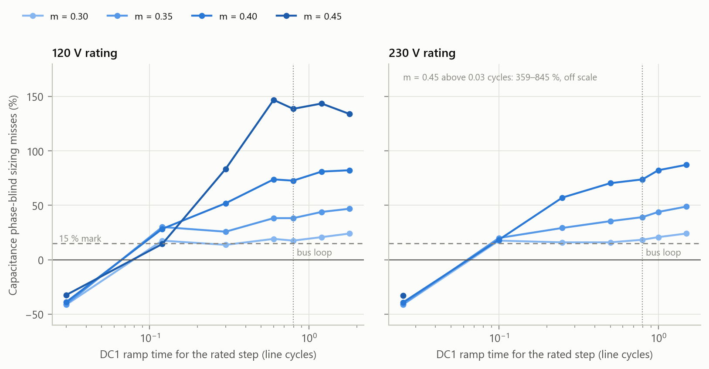
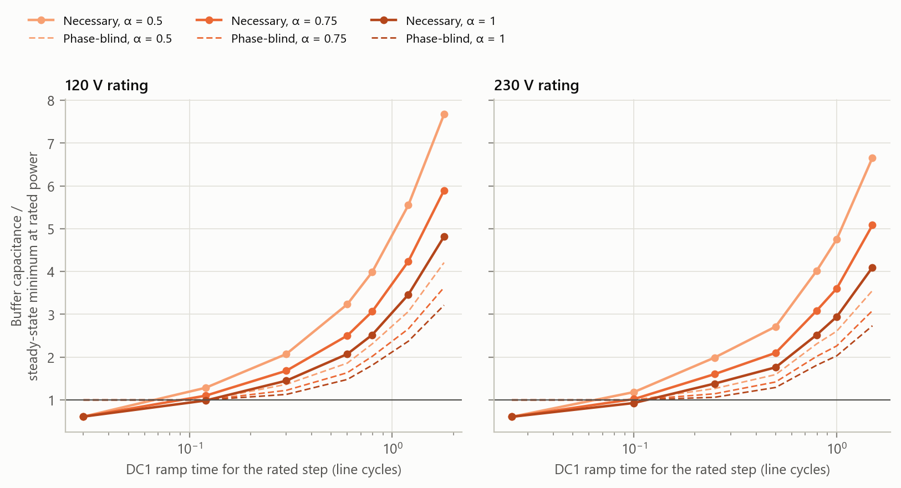

# WP5a: buffer sizing against phase-blind sizing

Generated by `sim/wp5a_report.py` from `results/wp5a/wp5a_*.json` (written by `sim/run_wp5a.py`). The protocol is `sim/WP5A_PROTOCOL.md`, including its revision before the campaign. Everything is simulation of the illustrative circuit.

## Verdicts

| Criterion | 120 V rating | 230 V rating |
|---|---|---|
| S1: penalty at the base design (α = 0.5) ≥ 15 % | **pass** (73 %) | **pass** (74 %) |
| S3: the 120 V chart predicts the 230 V penalty within ±10 points | **fail** (largest error 750 points, at m = 0.45; 13 points at m ≤ 0.40; m = 0.50 has no design) | |
| S4: switched-model verification | **fail** | **fail** |
| Post hoc: S4(a) with the current-aware sufficient bound (centred; m = 0.35, bus-loop ramp; no base design certified) | **pass** | **pass** |
| Post hoc: the same at the top operating point (α = 1) | **pass** | **pass** |

Phase searches without a solver verdict, even after retrying two other HiGHS methods: 4 of 8964 (left out of the maxima).

## Base design (m = 0.40, bus-loop DC1 ramp, rated step, unity power factor, α = 0.5)

| | 120 V rating | 230 V rating |
|---|---|---|
| Bus voltage | 425.0 V | 812.5 V |
| AC2 step | 1600 W | 3200 W |
| DC1 ramp time for the rated step | 13.3 ms (0.80 cycles) | 15.9 ms (0.80 cycles) |
| Steady-state minimum at the post-step power | 314 µF | 208 µF |
| Energy LP, worst phase | 724 µF | 480 µF |
| **Phase-blind sizing, Cb_conv** | **724 µF** | **480 µF** |
| **Necessary, Cb_nec (circuit outer bound)** | **1250 µF** at 30.0° | **834 µF** at 30.0° |
| Reduced outer bound (no inductor), for reference | 1490 µF | 987 µF |
| Sufficient, Cb_suff (inner bound) | 1693 µF at 30.0° | 1122 µF at 30.0° |
| **Penalty, Cb_nec / Cb_conv − 1** | **73 %** | **74 %** |
| Bracket, Cb_suff / Cb_nec | 1.35 | 1.35 |

## Design chart (S2)

Penalty in % at α = 0.5, rated step, unity power factor. Columns: DC1 ramp time for the rated step, in line cycles.

**120 V rating**

| m | 0.03 | 0.12 | 0.30 | 0.60 | 0.80 | 1.20 | 1.80 |
|---|---|---|---|---|---|---|---|
| 0.30 | −41 | **18** | 14 | **19** | **18** | **21** | **24** |
| 0.35 | −41 | **30** | **26** | **38** | **38** | **44** | **47** |
| 0.40 | −39 | **28** | **52** | **74** | **73** | **81** | **82** |
| 0.45 | −32 | 14 | **84** | **147** | **139** | **144** | **134** |
| 0.50 | no design | no design | no design | no design | no design | no design | no design |

Bold: at least 15 %. Below 15 % at 6 of 28 points with a design.

**230 V rating**

| m | 0.03 | 0.10 | 0.25 | 0.50 | 0.80 | 1.00 | 1.50 |
|---|---|---|---|---|---|---|---|
| 0.30 | −41 | **18** | **16** | **16** | **18** | **21** | **24** |
| 0.35 | −41 | **20** | **29** | **35** | **39** | **44** | **49** |
| 0.40 | −39 | **18** | **57** | **70** | **74** | **82** | **87** |
| 0.45 | −33 | **498** | **814** | **845** | **588** | **518** | **359** |
| 0.50 | no design | no design | no design | no design | no design | no design | no design |

Bold: at least 15 %. Below 15 % at 4 of 28 points with a design.

- **m = 0.50 has no design:** the pole band closes, so no steady-state orbit fits at any capacitance up to 20 mF.
- **m = 0.45 is at the feasibility edge:** no sufficient design exists at either rating, and at 230 V even the reduced outer bound finds none. The penalty there grows steeply and differs between ratings.
- **Negative values at the fastest ramp (0.5 ms):** the transient bound falls below the steady-state minimum that conventional sizing already includes. With a fast DC1, phase-aware sizing adds nothing.
- **Penalty grows with modulation index and with ramp time.** It already passes 15 % at 0.1 line cycle for m ≥ 0.30 at both ratings.

## Chart transfer between ratings (S3)

The 120 V chart, interpolated bilinearly in (m, ramp time in line cycles), predicts the 230 V penalty with a largest error of 750 points over 24 scored points, so S3 fails. Largest errors: m = 0.45, 0.25 cycles: 814 % against 64 % predicted; m = 0.45, 0.50 cycles: 845 % against 126 % predicted; m = 0.45, 0.10 cycles: 498 % against 4 % predicted.

- **Restricted to m ≤ 0.40 (post hoc),** the largest error is 13.1 points over 18 points. It sits where the penalty rises steeply at short ramps (0.03 to 0.30 line cycles), which the coarse ramp grid there cannot follow. Elsewhere the ratings agree closely (base design 73 % against 74 %).
- **At m = 0.45 the ratings diverge strongly.** The effective modulation index, peak converter voltage over bus voltage, equals the nominal one to within 0.004 at both ratings, so the filter inductors do not explain this.

## Operating point

Before the step the buffer runs on a steady orbit whose mean energy sits at position α of its admissible interval (0.5 centred, 1 highest). m = 0.40, rated step.

| Rating | DC1 ramp (cycles) | α | Cb_conv | Cb_nec | Penalty | Cb_nec / Cb_nec(α = 0.5) |
|---|---|---|---|---|---|---|
| 120 V rating | 0.03 | 0.5 | 314 µF | 192 µF | −39 % | 1.00 |
| 120 V rating | 0.12 | 0.5 | 314 µF | 402 µF | 28 % | 1.00 |
| 120 V rating | 0.30 | 0.5 | 428 µF | 650 µF | 52 % | 1.00 |
| 120 V rating | 0.60 | 0.5 | 583 µF | 1014 µF | 74 % | 1.00 |
| 120 V rating | 0.80 | 0.5 | 724 µF | 1250 µF | 73 % | 1.00 |
| 120 V rating | 1.20 | 0.5 | 961 µF | 1740 µF | 81 % | 1.00 |
| 120 V rating | 1.80 | 0.5 | 1319 µF | 2405 µF | 82 % | 1.00 |
| 120 V rating | 0.03 | 0.75 | 314 µF | 192 µF | −39 % | 1.00 |
| 120 V rating | 0.12 | 0.75 | 314 µF | 345 µF | 10 % | 0.86 |
| 120 V rating | 0.30 | 0.75 | 384 µF | 527 µF | 37 % | 0.81 |
| 120 V rating | 0.60 | 0.75 | 513 µF | 785 µF | 53 % | 0.77 |
| 120 V rating | 0.80 | 0.75 | 632 µF | 961 µF | 52 % | 0.77 |
| 120 V rating | 1.20 | 0.75 | 834 µF | 1328 µF | 59 % | 0.76 |
| 120 V rating | 1.80 | 0.75 | 1137 µF | 1849 µF | 63 % | 0.77 |
| 120 V rating | 0.03 | 1 | 314 µF | 192 µF | −39 % | 1.00 |
| 120 V rating | 0.12 | 1 | 314 µF | 309 µF | −1 % | 0.77 |
| 120 V rating | 0.30 | 1 | 354 µF | 454 µF | 28 % | 0.70 |
| 120 V rating | 0.60 | 1 | 464 µF | 650 µF | 40 % | 0.64 |
| 120 V rating | 0.80 | 1 | 568 µF | 790 µF | 39 % | 0.63 |
| 120 V rating | 1.20 | 1 | 744 µF | 1085 µF | 46 % | 0.62 |
| 120 V rating | 1.80 | 1 | 1007 µF | 1510 µF | 50 % | 0.63 |
| 230 V rating | 0.03 | 0.5 | 208 µF | 126 µF | −39 % | 1.00 |
| 230 V rating | 0.10 | 0.5 | 208 µF | 246 µF | 18 % | 1.00 |
| 230 V rating | 0.25 | 0.5 | 263 µF | 413 µF | 57 % | 1.00 |
| 230 V rating | 0.50 | 0.5 | 331 µF | 564 µF | 70 % | 1.00 |
| 230 V rating | 0.80 | 0.5 | 480 µF | 834 µF | 74 % | 1.00 |
| 230 V rating | 1.00 | 0.5 | 542 µF | 987 µF | 82 % | 1.00 |
| 230 V rating | 1.50 | 0.5 | 739 µF | 1383 µF | 87 % | 1.00 |
| 230 V rating | 0.03 | 0.75 | 208 µF | 126 µF | −39 % | 1.00 |
| 230 V rating | 0.10 | 0.75 | 208 µF | 212 µF | 2 % | 0.86 |
| 230 V rating | 0.25 | 0.75 | 238 µF | 333 µF | 40 % | 0.81 |
| 230 V rating | 0.50 | 0.75 | 295 µF | 436 µF | 48 % | 0.77 |
| 230 V rating | 0.80 | 0.75 | 419 µF | 641 µF | 53 % | 0.77 |
| 230 V rating | 1.00 | 0.75 | 470 µF | 749 µF | 59 % | 0.76 |
| 230 V rating | 1.50 | 0.75 | 641 µF | 1056 µF | 65 % | 0.76 |
| 230 V rating | 0.03 | 1 | 208 µF | 126 µF | −39 % | 1.00 |
| 230 V rating | 0.10 | 1 | 208 µF | 193 µF | −7 % | 0.78 |
| 230 V rating | 0.25 | 1 | 221 µF | 287 µF | 30 % | 0.69 |
| 230 V rating | 0.50 | 1 | 269 µF | 366 µF | 36 % | 0.65 |
| 230 V rating | 0.80 | 1 | 376 µF | 524 µF | 39 % | 0.63 |
| 230 V rating | 1.00 | 1 | 422 µF | 611 µF | 45 % | 0.62 |
| 230 V rating | 1.50 | 1 | 568 µF | 851 µF | 50 % | 0.62 |

**Reading.**

- **Raising the operating point to the top of its interval (α = 1) lowers the necessary capacitance by about a third** at ramps of half a line cycle or more.
- **The penalty remains.** At the base ramp it is 39 % and 39 % against phase-blind sizing at the same operating point. Against phase-blind sizing as usually computed from the centred orbit (724 µF, 480 µF), it is 9 % and 9 %.
- **At ramps of about 0.1 line cycle,** the top operating point removes the penalty altogether.

## Step size and AC2 power factor (base design, α = 0.5)

| Rating | Case | Cb_conv | Cb_nec | Cb_suff | Penalty |
|---|---|---|---|---|---|
| 120 V rating | step to 50 % of rating | 205 µF | 244 µF | 299 µF | 19 % |
| 120 V rating | step to 75 % of rating | 345 µF | 560 µF | 729 µF | 63 % |
| 120 V rating | step to 100 % (base) | 724 µF | 1250 µF | 1693 µF | 73 % |
| 120 V rating | power factor 0.9 lagging | 769 µF | 1328 µF | 1693 µF | 73 % |
| 120 V rating | power factor 0.8 lagging | 812 µF | 1402 µF | 1728 µF | 73 % |
| 120 V rating | power factor 0.8 leading | 744 µF | 1293 µF | 1978 µF | 74 % |
| 230 V rating | step to 50 % of rating | 135 µF | 164 µF | 200 µF | 22 % |
| 230 V rating | step to 75 % of rating | 230 µF | 379 µF | 489 µF | 65 % |
| 230 V rating | step to 100 % (base) | 480 µF | 834 µF | 1122 µF | 74 % |
| 230 V rating | power factor 0.9 lagging | 510 µF | 892 µF | 1145 µF | 75 % |
| 230 V rating | power factor 0.8 lagging | 538 µF | 948 µF | 1176 µF | 76 % |
| 230 V rating | power factor 0.8 leading | 489 µF | 868 µF | 1310 µF | 77 % |

## Load drop against operating point (S6, indicative)

A higher operating point helps step-ups and hurts load drops. Smallest Cb that admits the drop of AC2 to zero load at every phase, from the same orbit. The circuit outer LP is valid but loose for surplus, so its load-drop value is a weak lower bound.

| Rating | α | Step-up Cb_nec | Load drop, energy LP | Load drop, circuit outer | Load drop, reduced outer (post hoc) |
|---|---|---|---|---|---|
| 120 V rating | 0.5 | 1250 µF | 192 µF | 192 µF | 206 µF |
| 120 V rating | 0.75 | 961 µF | 192 µF | 192 µF | 212 µF |
| 120 V rating | 1 | 790 µF | 192 µF | 192 µF | 230 µF |
| 230 V rating | 0.5 | 834 µF | 126 µF | 126 µF | 139 µF |
| 230 V rating | 0.75 | 641 µF | 126 µF | 126 µF | 145 µF |
| 230 V rating | 1 | 524 µF | 126 µF | 126 µF | 161 µF |

- **The energy LP and the circuit outer LP** both stop at the smallest capacitance for which the pre-step orbit exists. They cannot see the cost of a high operating point on load drops.
- **The reduced outer LP** keeps the buffer voltage inside the band, so it is tight for surplus, though it ignores the inductor. Added post hoc, it shows the load drop needs only a little more capacitance as α rises, far less than the step-up needs.
- **So for this event set, a high operating point at light load is nearly free.** A load drop from rated load starts from a different operating point (the orbit at rated load), which a controller can place low.

## Checks (S5)

- 120 V rating: feasibility monotone in Cb at the worst phase: energy yes, inner yes, circuit yes. Circuit bound with three versus five post-step cycles: 1250 µF versus 1250 µF.
- 230 V rating: feasibility monotone in Cb at the worst phase: energy yes, inner yes, circuit yes. Circuit bound with three versus five post-step cycles: 834 µF versus 834 µF.

## Switched-model verification (S4)

| Rating | Case | Cb | Phase | Result |
|---|---|---|---|---|
| 120 V rating | plan_at_suff | 1693 µF | 30.0° | tripped at 11.4 ms |
| 120 V rating | conventional_at_conv | 724 µF | 30.0° | tripped at 2.5 ms |
| 120 V rating | conventional_at_0.95nec | 1188 µF | 30.0° | tripped at 11.1 ms |
| 230 V rating | plan_at_suff | 1122 µF | 30.0° | tripped at 3.1 ms |
| 230 V rating | conventional_at_conv | 480 µF | 30.0° | tripped at 2.7 ms |
| 230 V rating | conventional_at_0.95nec | 792 µF | 30.0° | tripped at 2.9 ms |

(b) and (c) hold: conventional sizing and anything below the necessary value trip. (a) fails: the inner bound leaves out the pole-current limit and the voltage the buffer inductor needs, and its plans exceed the current limit by 1–2 A.

**Post hoc: the same plan with more capacitance.** Inner-LP plan tracked at the worst phase with Cb = k × Cb_suff.

| Rating | k | Cb | Plan's own peak pole-N current | Switched result |
|---|---|---|---|---|
| 120 V rating | 1 | 1693 µF | 66.9 A (limit 66 A) | trip at 11.4 ms (bus) |
| 120 V rating | 1.25 | 2117 µF | 67.7 A (limit 66 A) | held |
| 120 V rating | 1.5 | 2540 µF | 68.0 A (limit 66 A) | held |
| 120 V rating | 2 | 3387 µF | 67.7 A (limit 66 A) | held |
| 120 V rating | 3 | 5080 µF | 68.3 A (limit 66 A) | held |
| 230 V rating | 1 | 1122 µF | 70.1 A (limit 69 A) | trip at 3.1 ms (pole current) |
| 230 V rating | 1.25 | 1403 µF | 70.9 A (limit 69 A) | trip at 2.9 ms (pole current) |
| 230 V rating | 1.5 | 1683 µF | 71.2 A (limit 69 A) | trip at 2.9 ms (pole current) |
| 230 V rating | 2 | 2244 µF | 70.8 A (limit 69 A) | trip at 2.9 ms (pole current) |
| 230 V rating | 3 | 3366 µF | 71.5 A (limit 69 A) | trip at 3.0 ms (pole current) |

- **120 V:** a plan holds from 1.25 × Cb_suff.
- **230 V:** no capacitance helps. Near the line peak the buffer must carry the DC1 deficit on top of the ripple current, which exceeds the pole-current limit, so the rated step at this rating is limited by current, not by energy.
- **Consequence:** a certified sufficient value needs an inner bound with the pole-current limit and the inductor voltage. The linear version tried here (current within 90 % of the limit, buffer voltage bounded by its secant) is infeasible at every capacitance, because at rated power the pole-N current is already within about 10 % of its limit in steady state.

## Current-aware sufficient bound (post hoc)

Defined in the protocol's addendum (`inner_circuit.py`). It certifies a trajectory of the averaged circuit with:

- the pole-N current within 97 % of its limit;
- the bus 2 % inside its limits (raised from 1 % during the S4(a) checks; see the protocol addendum);
- the buffer current changing by at most 36 A/ms;
- a search that starts at the steady-state minimum with the inner headroom, so the plan ends in a steady state a controller can hold;
- the pole-N band with the inner headroom.

Main chart, centred operating point. Each cell gives Cb_suff,c in µF and, in brackets, its ratio to the larger of Cb_nec and the steady-state minimum. Each value is certified at the worst phase and eight more phases 45° apart.

**120 V rating**

| m | 0.03 | 0.12 | 0.30 | 0.60 | 0.80 | 1.20 | 1.80 |
|---|---|---|---|---|---|---|---|
| 0.30 | 121 (1.06) | 171 (1.15) | 269 (1.11) | 412 (1.19) | 508 (1.19) | 697 (1.19) | 983 (1.19) |
| 0.35 | 202 (1.08) | 280 (1.15) | 449 (1.15) | 747 (1.27) | 865 (1.19) | 1290 (1.27) | 1870 (1.32) |
| 0.40 | 352 (1.12) | 478 (1.19) | 1367 (2.10) | not certified | not certified | not certified | not certified |
| 0.45 | 754 (1.25) | not certified | not certified | not certified | not certified | not certified | not certified |

**230 V rating**

| m | 0.03 | 0.10 | 0.25 | 0.50 | 0.80 | 1.00 | 1.50 |
|---|---|---|---|---|---|---|---|
| 0.30 | 189 (2.52) | 168 (1.86) | 181 (1.19) | 242 (1.26) | 316 (1.11) | 377 (1.15) | 532 (1.15) |
| 0.35 | 138 (1.11) | 220 (1.49) | 274 (1.11) | 388 (1.19) | 558 (1.15) | 674 (1.19) | 957 (1.19) |
| 0.40 | 231 (1.11) | 292 (1.19) | 522 (1.26) | not certified | not certified | not certified | not certified |
| 0.45 | 600 (1.51) | not certified | not certified | not certified | not certified | not certified | not certified |

Certified at 36 of 56 points.

- **"Not certified":** the search found no certificate up to three times the base value. The method is local, so this is not a proof that none exists.
- **At the base design with the centred operating point,** every attempt at both ratings leaves a pole-N current overshoot of 1–4 A near the line peak, 2.5–3 ms after the step. That is consistent with the step being limited by pole current there, not by capacitance.

**Top operating point (α = 1), base design.** The same bound, with the buffer held at the top of its band before the step. The last columns track the certified plan in the switched model:

| Rating | Cb_nec (α = 1) | Cb_suff,c (α = 1) | Ratio | Smoothed-bus tracker | Flat-bus tracker | Energy tracker |
|---|---|---|---|---|---|---|
| 120 V rating | 790 µF | 1076 µF | 1.36 | held; bus 416–436 V, current 61.1 A | held; bus 409–443 V, current 61.5 A | held; bus 407–443 V, current 62.0 A |
| 230 V rating | 524 µF | 601 µF | 1.15 | held; bus 788–825 V, current 66.5 A | held; bus 787–838 V, current 67.1 A | held; bus 783–838 V, current 67.1 A |

**S4(a) rerun with the certified plans, centred operating point.** No base design is certified there, so each rating's certified point at the bus-loop ramp with the largest m is tested (worst phase, switched model, plan continued by repeating its last cycle):

| Rating | m | Cb | Plan's peak pole-N current | Smoothed-bus tracker | Flat-bus tracker | Energy tracker |
|---|---|---|---|---|---|---|
| 120 V rating | 0.35 | 865 µF | 64.0 A | held; bus 470–497 V, current 61.1 A | held; bus 468–507 V, current 61.6 A | trip at 12.6 ms (bus); bus 461–508 V, current 62.1 A |
| 230 V rating | 0.35 | 558 µF | 66.9 A | held; bus 897–942 V, current 66.4 A | held; bus 899–956 V, current 66.7 A | held; bus 893–956 V, current 66.3 A |

**S4(b) and (c) with the timing fix.** The conventional controller with the final tracker's buffer-loop timing still trips: 120 V rating, 724 µF: trip at 2.5 ms; 120 V rating, 1188 µF: trip at 10.8 ms; 230 V rating, 480 µF: trip at 2.7 ms; 230 V rating, 792 µF: trip at 2.9 ms.

**S4(a) across the main chart.** Every certified point, centred operating point, worst phase, tracked in the switched model:

| Rating | Tracker | Held | Tested | Smallest bus margin | Within 1 % of a bus limit | Largest pole-N current |
|---|---|---|---|---|---|---|
| 120 V rating | smoothed-bus tracker | 17 | 18 | -14.9 V | 2 | 61.4 A (limit 66 A) |
| 120 V rating | flat-bus tracker | 15 | 18 | -31.6 V | 13 | 61.7 A (limit 66 A) |
| 120 V rating | energy tracker (follows the plan's bus) | 10 | 18 | -43.8 V | 10 | 62.1 A (limit 66 A) |
| 230 V rating | smoothed-bus tracker | 17 | 18 | -5.7 V | 1 | 66.7 A (limit 69 A) |
| 230 V rating | flat-bus tracker | 16 | 18 | -25.5 V | 1 | 67.0 A (limit 69 A) |
| 230 V rating | energy tracker (follows the plan's bus) | 15 | 18 | -26.1 V | 7 | 66.9 A (limit 69 A) |

Failures with the smoothed-bus tracker: 120 V rating, m = 0.45, ramp 0.5 ms: trip at 12.8 ms (bus); bus 344–388 V, current 56.5 A; 230 V rating, m = 0.45, ramp 0.5 ms: trip at 46.7 ms (bus); bus 680–735 V, current 53.8 A.

- **Trackers.** All three follow the plan's DC1 power and stored energy. They differ in the bus reference:
  - the **energy tracker** follows the plan's bus sample by sample and feeds its rate forward. The plans move the bus by about ±5 V at 120 Hz in steps on their 83 µs grid, and those steps ask for buffer-power pulses that saturate pole N;
  - the **flat-bus tracker** holds the bus at nominal. It fails where the plan needs the bus capacitor's share of the ripple: fast DC1 ramps at the steady-state minimum;
  - the **smoothed-bus tracker** (policy `plan_smooth`) follows a 15-sample (1.25 ms) moving average of the plan's bus. It keeps the plan's 120 Hz use of the bus capacitor and drops the steps.
- **Buffer-loop timing.** The smoothed-bus tracker also compares the buffer current with its reference at the measurement instant (gain `sync_ib`), as the AC loops do. The earlier loop compared the measured current with the reference for the period the duty acts in, 1.5 switching periods later. The buffer current then ran about 110 µs ahead of the ripple it carries, which a 23 µF bus feels at once.
  At the 120 V S4 point the bus swing went from -18/+21 V (flat-bus tracker) to -16/+12 V.
- **Margins.** On the plans that held, the bus stays within 4.4 % of nominal at 120 V and 4.6 % at 230 V, against limits of ±5 %. 3 of the 34 came within 1 % of a limit; the closest margin is 2.50 V.
- **The failures are at m = 0.45 with a 0.5 ms ramp,** the edge of feasibility. There the plans swing DC1 by several kilowatts within a few milliseconds while the buffer runs low, and the tracked buffer cannot follow. In a side test no tracker held at 120 V up to 1507 µF, twice the chart value. At 230 V the smoothed-bus tracker held at 1163 µF (1.9 times), with a 1.3 V margin. These points need a tracker that follows the plan's full state.
- **Variants tried and dropped, all worse:**
  - following the plan's buffer current (`circuit_plan`) or its pole-N voltage (`state_plan`);
  - feeding forward the buffer inductor's power;
  - extrapolating DC1 power to the duty's period;
  - a faster bus loop: 400 Hz helped, 600 Hz was unstable;
  - an integral term on the bus loop;
  - in the bound, 5–10 % DC1 headroom;
  - in the bound, a final-cycle bus band. That was infeasible, because by the final cycle the bound's bus-energy bracket spans 4–5 % of nominal at 120 V.

## Closed-form approximation (post hoc)

Fitted to the 120 V chart and tested on the 230 V chart, for ramp times of at least 0.1 line cycle: penalty (%) ≈ 69.1 + 10.2 ln(T_r f) + 462 (m − 0.4). Fit error: largest 19.1 points, RMS 8.1. Test on 230 V: largest 27.2 points, RMS 9.7. Range of validity: m from 0.30 to 0.40, ramp times from 0.1 to 1.8 line cycles, the rated step, unity power factor and the centred operating point.
